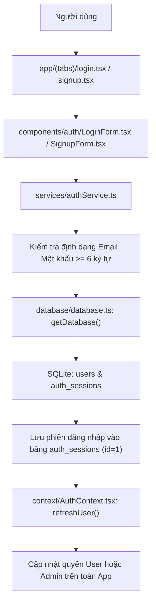
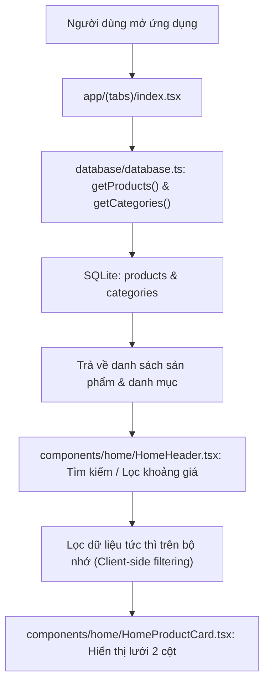
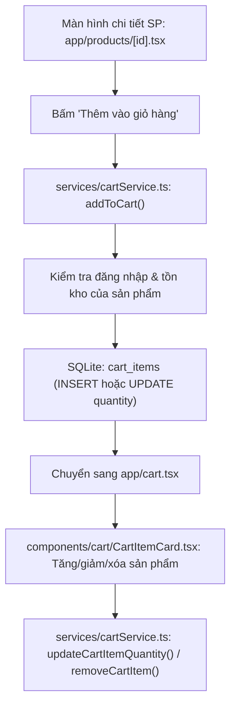
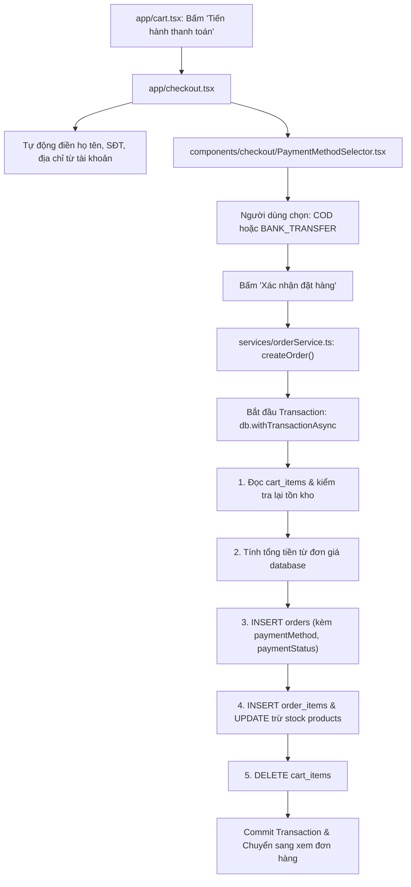
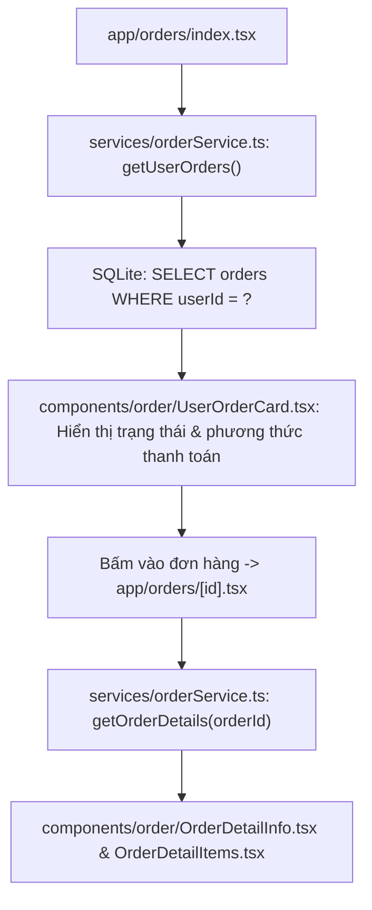
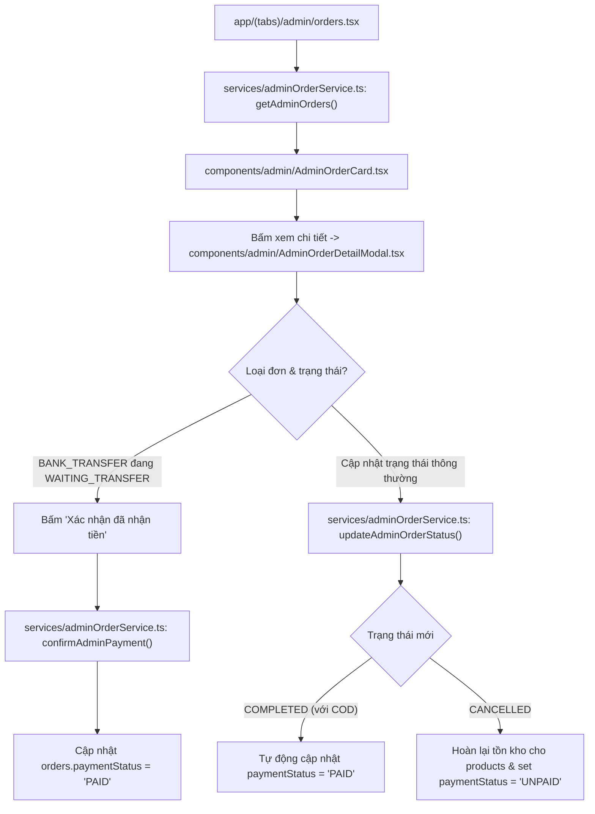

# HƯỚNG DẪN HOÀN THIỆN THANH TOÁN VÀ TỐI ƯU TOÀN BỘ SOURCE CODE DỰ ÁN HAPPY

> **Dự án**: Happy – Học tập vui hơn, mỗi ngày tiện hơn  
> **Nền tảng**: React Native (Expo SDK 58, TypeScript, Expo Router, SQLite `expo-sqlite`)  
> **Đối tượng sử dụng tài liệu**: Sinh viên học lập trình React Native, dùng để học tập, review code và chuẩn bị báo cáo/bảo vệ dự án trước giảng viên.

---

## 1. TỔNG QUAN DỰ ÁN

### 1.1. Công nghệ đang sử dụng
- **React Native 0.88.1** & **React 19.3.0**.
- **Expo SDK 58** (`expo ~58.0.22`, `expo-router ~58.0.29`).
- **TypeScript 6.0.3** với cấu hình type check nghiêm ngặt (`npx tsc --noEmit` đạt 0 lỗi).
- **SQLite** thông qua module hiện đại `expo-sqlite` (hỗ trợ asynchronous API: `openDatabaseAsync`, `execAsync`, `getAllAsync`, `getFirstAsync`, `runAsync`, `withTransactionAsync`).
- **Expo File System & Expo Image Picker**: chọn ảnh sản phẩm từ Album điện thoại và lưu trữ bền vững trong thư mục ứng dụng (`Paths.document/product-images`).
- **React Hooks**: `useState`, `useEffect`, `useCallback`, `useFocusEffect` (Expo Router).
- **React Native StyleSheet**: giữ trọn bộ định dạng nguyên bản, màu sắc thương hiệu `#338DA3`, `#E76F32`/`#E76F51`, nền `#F5F7FA`/`#F8FAFC`.
- **Safe Area**: `react-native-safe-area-context` bảo vệ giao diện không tràn tai thỏ và thanh điều hướng.

---

### 1.2. Cấu trúc thư mục sau khi tối ưu

```text
stationery-store-app/
├── assets/                          # Ảnh banner, logo, icon
│   └── images/banners/              # 3 ảnh banner chính thức
├── docs/                            # Tài liệu dự án
│   └── PROJECT_OPTIMIZATION_AND_PAYMENT_GUIDE.md
├── src/
│   ├── app/                         # Các màn hình định tuyến theo Expo Router
│   │   ├── _layout.tsx              # Root Stack Navigator & AuthProvider
│   │   ├── explore.tsx              # Route phụ Expo template
│   │   ├── cart.tsx                 # Màn hình Giỏ hàng
│   │   ├── checkout.tsx             # Màn hình Thanh toán (đã hoàn thiện COD & Chuyển khoản)
│   │   ├── profile.tsx              # Màn hình Thông tin cá nhân & Đăng xuất
│   │   ├── (tabs)/                  # Bottom Tabs chính
│   │   │   ├── _layout.tsx          # Tab Navigator
│   │   │   ├── index.tsx            # Tab 1: Trang chủ User (Home)
│   │   │   ├── login.tsx            # Tab 4: Đăng nhập
│   │   │   ├── signup.tsx           # Tab 3: Đăng ký
│   │   │   └── admin/               # Tab 2: Dành riêng cho Quản trị viên (Admin)
│   │   │       ├── _layout.tsx      # Sub-layout Admin
│   │   │       ├── index.tsx        # Admin Dashboard
│   │   │       ├── categories.tsx   # Quản lý danh mục
│   │   │       ├── products.tsx     # Quản lý sản phẩm & chọn ảnh
│   │   │       ├── orders.tsx       # Quản lý đơn & xác nhận thanh toán
│   │   │       └── users.tsx        # Quản lý người dùng & phân quyền
│   │   ├── orders/
│   │   │   ├── index.tsx            # Lịch sử đơn hàng của User
│   │   │   └── [id].tsx             # Chi tiết đơn hàng của User
│   │   └── products/
│   │       └── [id].tsx             # Chi tiết sản phẩm & Thêm vào giỏ
│   ├── components/                  # Giao diện thành phần (được chia nhỏ tái sử dụng)
│   │   ├── admin/                   # Component cho trang quản trị
│   │   │   ├── AdminCategoryCard.tsx
│   │   │   ├── AdminMenuCard.tsx
│   │   │   ├── AdminOrderCard.tsx
│   │   │   ├── AdminOrderDetailModal.tsx
│   │   │   ├── AdminProductCard.tsx
│   │   │   ├── AdminUserCard.tsx
│   │   │   ├── CategoryFormModal.tsx
│   │   │   └── ProductFormModal.tsx
│   │   ├── auth/                    # Component giao diện đăng nhập/đăng ký
│   │   │   ├── LoggedInView.tsx
│   │   │   ├── LoginForm.tsx
│   │   │   └── SignupForm.tsx
│   │   ├── cart/                    # Component giỏ hàng
│   │   │   ├── CartItemCard.tsx
│   │   │   ├── CartSummary.tsx
│   │   │   └── EmptyCart.tsx
│   │   ├── checkout/                # Component thanh toán
│   │   │   ├── CheckoutItemList.tsx
│   │   │   ├── CheckoutSummary.tsx
│   │   │   ├── PaymentMethodSelector.tsx
│   │   │   └── RecipientForm.tsx
│   │   ├── home/                    # Component trang chủ
│   │   │   ├── HomeHeader.tsx
│   │   │   └── HomeProductCard.tsx
│   │   ├── order/                   # Component lịch sử & chi tiết đơn user
│   │   │   ├── OrderDetailInfo.tsx
│   │   │   ├── OrderDetailItems.tsx
│   │   │   └── UserOrderCard.tsx
│   │   ├── product/                 # Component chi tiết sản phẩm
│   │   │   └── ProductDetailBody.tsx
│   │   ├── profile/                 # Component hồ sơ cá nhân
│   │   │   └── ProfileForm.tsx
│   │   ├── Banner.tsx               # Banner tự động trượt
│   │   ├── CategorySelector.tsx     # Bộ chọn danh mục ngang
│   │   ├── Header.tsx               # Header thông tin admin/user
│   │   ├── HomeTopBar.tsx           # Thanh logo, thương hiệu & badge giỏ hàng
│   │   ├── ProductSearchFilter.tsx  # Bộ lọc tìm kiếm & giá
│   │   ├── app-tabs.tsx             # Native bottom tabs (mobile)
│   │   └── app-tabs.web.tsx         # Fallback bottom tabs (web)
│   ├── context/
│   │   └── AuthContext.tsx          # Quản lý phiên đăng nhập toàn app
│   ├── database/
│   │   ├── database.ts              # Mở DB, migration, bảng, helper queries
│   │   └── initialData.ts           # Dữ liệu danh mục & sản phẩm mẫu ban đầu
│   ├── services/                    # Xử lý logic nghiệp vụ và giao tiếp DB
│   │   ├── adminOrderService.ts     # Quản lý đơn hàng Admin & xác nhận thanh toán
│   │   ├── authService.ts           # Đăng ký, đăng nhập, phiên đăng nhập, đăng xuất
│   │   ├── cartService.ts           # Giỏ hàng, tồn kho, tính tiền
│   │   ├── categoryService.ts       # Nghiệp vụ quản lý danh mục
│   │   ├── orderService.ts          # Đặt hàng transaction, lịch sử đơn
│   │   ├── productService.ts        # CRUD sản phẩm, kiểm tra ràng buộc
│   │   ├── profileService.ts        # Cập nhật họ tên, SĐT, địa chỉ cá nhân
│   │   └── userService.ts           # Đổi vai trò, xóa người dùng
│   ├── types/                       # TypeScript interfaces và types tập trung
│   │   ├── category.ts              # Interface danh mục
│   │   ├── order.ts                 # Types đơn hàng, thanh toán, helper labels
│   │   ├── product.ts               # Interface sản phẩm
│   │   └── user.ts                  # Types tài khoản, vai trò
│   └── utils/
│       └── imageUtils.ts            # Tiện ích chọn và lưu ảnh Album vào ứng dụng
├── package.json
└── tsconfig.json
```

### 1.3. Vai trò của từng thư mục
- **`src/app/`**: Chịu trách nhiệm về màn hình (Screen) và điều hướng (Navigation). Mỗi file route chỉ tập trung vào việc quản lý state màn hình, gọi service lấy dữ liệu và hiển thị component. Không trực tiếp viết câu truy vấn SQL hay thuật toán dài dòng tại đây.
- **`src/components/`**: Chứa các khối giao diện UI nhỏ, độc lập, có thể tái sử dụng. Các card, form, modal được tách riêng vào đây để màn hình chính ngắn gọn và dễ đọc.
- **`src/services/`**: Nơi thực hiện toàn bộ nghiệp vụ (Business Logic) như kiểm tra tính hợp lệ dữ liệu (validation), kiểm tra tồn kho, chạy các giao dịch an toàn (transaction) và truy vấn SQLite.
- **`src/database/`**: Quản lý kết nối cơ sở dữ liệu `stationery_store.db`, thực thi câu lệnh tạo bảng, chạy migration giữ nguyên dữ liệu cũ và gieo mầm dữ liệu ban đầu (seed data).
- **`src/context/`**: Quản lý trạng thái chia sẻ toàn ứng dụng (cụ thể là `AuthContext` để lưu trữ người dùng hiện tại và đồng bộ giữa các tab).
- **`src/types/`**: Khai báo các giao diện (interface) và kiểu dữ liệu (type) dùng chung trong TypeScript, giúp code đồng nhất, tránh khai báo trùng lặp.
- **`src/utils/`**: Các hàm trợ giúp dùng chung (chọn ảnh, lưu file, chuẩn hóa chuỗi).

---

## 2. NHỮNG THAY ĐỔI ĐÃ THỰC HIỆN

### 2.1. Danh sách file đã sửa đổi
1. `src/database/database.ts`:
   - Bổ sung migration tự động qua `PRAGMA table_info(orders)` để thêm hai cột `paymentMethod` và `paymentStatus` vào bảng `orders` mà không xóa dữ liệu cũ.
   - Chuyển mảng dữ liệu ban đầu sang `initialData.ts` để code gọn gàng, loại bỏ các lệnh `console.log` in toàn bộ mảng dữ liệu lớn.
2. `src/services/orderService.ts`:
   - Tiếp nhận `paymentMethod` ("COD" hoặc "BANK_TRANSFER") khi tạo đơn hàng.
   - Gán `paymentStatus`: mặc định `UNPAID` với COD, `WAITING_TRANSFER` với BANK_TRANSFER.
   - Lưu trữ an toàn trong `db.withTransactionAsync`: kiểm tra tồn kho, tính lại tổng tiền từ database, ghi đơn hàng, trừ tồn kho, xóa giỏ hàng.
   - Bổ sung `paymentMethod` và `paymentStatus` vào `getUserOrders` và `getOrderDetails`.
3. `src/services/adminOrderService.ts`:
   - Bổ sung hàm `confirmAdminPayment(orderId)` cho phép Admin xác nhận nhận tiền chuyển khoản (chỉ áp dụng cho đơn `BANK_TRANSFER` đang `WAITING_TRANSFER`).
   - Cập nhật quy tắc chuyển trạng thái:
     * Đơn `BANK_TRANSFER` chưa thanh toán (`paymentStatus !== 'PAID'`) thì không được chuyển sang `COMPLETED`.
     * Đơn `COD` khi chuyển sang `COMPLETED` sẽ tự động chuyển `paymentStatus = 'PAID'`.
     * Không cho phép hủy đơn hàng đã thanh toán (`paymentStatus === 'PAID'`) bằng thao tác thông thường.
     * Khi hủy đơn (`CANCELLED`): hoàn lại số lượng tồn kho và cập nhật trạng thái thanh toán từ `WAITING_TRANSFER` về `UNPAID` để không còn mang nghĩa chờ chuyển khoản.
4. `src/app/checkout.tsx`:
   - Bổ sung khối chọn phương thức thanh toán với 2 lựa chọn: COD (mặc định) và Chuyển khoản ngân hàng.
   - Thêm hiển thị lưu ý rõ ràng đây là mô phỏng thủ công trong phạm vi bài tập.
   - Tách các khối giao diện thành các sub-components.
5. `src/app/orders/index.tsx` & `src/app/orders/[id].tsx`:
   - Hiển thị đầy đủ phương thức thanh toán và trạng thái thanh toán (kèm nhãn tiếng Việt rõ ràng) cho từng đơn hàng của người dùng.
6. `src/app/(tabs)/admin/orders.tsx`:
   - Hiển thị phương thức và trạng thái thanh toán trên danh sách và trong modal chi tiết.
   - Hiển thị nút "Xác nhận đã nhận tiền" khi đơn `BANK_TRANSFER` đang ở trạng thái `WAITING_TRANSFER`.
7. `src/app/cart.tsx`, `src/app/(tabs)/index.tsx`, `src/app/(tabs)/admin/products.tsx`, `src/app/(tabs)/admin/categories.tsx`, `src/app/(tabs)/admin/users.tsx`, `src/app/(tabs)/login.tsx`, `src/app/(tabs)/signup.tsx`, `src/app/profile.tsx`, `src/app/products/[id].tsx`, `src/components/Header.tsx`:
   - Refactor bóc tách các component con, đưa độ dài mỗi file về khoảng 100 dòng code.
   - Giữ nguyên 100% giao diện, phong cách màu sắc, Safe Area và hành vi hiện tại.
8. `src/components/Banner.tsx`, `src/components/app-tabs.web.tsx`:
   - Sửa lỗi typing với React 19 để `npx tsc --noEmit` hoàn toàn không còn lỗi.

### 2.2. Danh sách file mới tạo
1. `src/types/order.ts`: Khai báo tập trung toàn bộ type, interface và helper format cho đơn hàng, phương thức và trạng thái thanh toán.
2. `src/types/user.ts`: Khai báo tập trung type người dùng (`AuthenticatedUser`, `UserRole`, `ManagedUser`).
3. `src/database/initialData.ts`: Lưu trữ mảng danh mục và sản phẩm mẫu ban đầu của Happy Store.
4. `src/utils/imageUtils.ts`: Hàm `pickProductImage` dùng `expo-image-picker` và `expo-file-system` lưu ảnh vào bộ nhớ ứng dụng.
5. `src/components/checkout/PaymentMethodSelector.tsx`: Component chọn COD hoặc Chuyển khoản ngân hàng.
6. `src/components/checkout/RecipientForm.tsx`: Form nhập họ tên, SĐT, địa chỉ nhận hàng.
7. `src/components/checkout/CheckoutItemList.tsx`: Danh sách sản phẩm tóm tắt khi checkout.
8. `src/components/checkout/CheckoutSummary.tsx`: Khối tổng tiền và nút bấm xác nhận đặt hàng.
9. `src/components/order/UserOrderCard.tsx`: Card hiển thị đơn hàng trong danh sách lịch sử của User.
10. `src/components/order/OrderDetailInfo.tsx`: Khối thông tin đơn hàng và thông tin nhận hàng của User.
11. `src/components/order/OrderDetailItems.tsx`: Khối danh sách sản phẩm và tổng tiền trong chi tiết đơn hàng.
12. `src/components/admin/AdminOrderCard.tsx`: Card hiển thị đơn hàng trong danh sách quản lý của Admin.
13. `src/components/admin/AdminOrderDetailModal.tsx`: Modal chi tiết đơn hàng cho Admin, chứa nút xác nhận thanh toán và các nút đổi trạng thái.
14. `src/components/admin/AdminProductCard.tsx`: Card hiển thị sản phẩm của Admin kèm nút sửa/xóa.
15. `src/components/admin/ProductFormModal.tsx`: Modal thêm/sửa sản phẩm kèm chọn ảnh và chọn danh mục.
16. `src/components/admin/AdminCategoryCard.tsx`: Card danh mục kèm số sản phẩm và nút thêm SP nhanh.
17. `src/components/admin/CategoryFormModal.tsx`: Modal thêm/sửa tên danh mục.
18. `src/components/admin/AdminUserCard.tsx`: Card hiển thị người dùng kèm nút đổi vai trò và nút xóa.
19. `src/components/admin/AdminMenuCard.tsx`: Card điều hướng 4 mục trên Admin Dashboard.
20. `src/components/cart/CartItemCard.tsx`: Card sản phẩm trong giỏ hàng kèm tăng giảm số lượng và xóa.
21. `src/components/cart/CartSummary.tsx`: Khối tổng tiền giỏ hàng và nút tiến hành thanh toán.
22. `src/components/cart/EmptyCart.tsx`: Giao diện khi giỏ hàng trống.
23. `src/components/home/HomeProductCard.tsx`: Card sản phẩm dạng lưới 2 cột tại trang chủ.
24. `src/components/home/HomeHeader.tsx`: Phần đầu trang chủ chứa TopBar, Banner, Lọc giá và Menu danh mục.
25. `src/components/auth/LoggedInView.tsx`: Màn hình thông báo người dùng đã đăng nhập kèm nút đăng xuất.
26. `src/components/auth/LoginForm.tsx`: Form nhập email, mật khẩu đăng nhập.
27. `src/components/auth/SignupForm.tsx`: Form đăng ký tài khoản đầy đủ trường.
28. `src/components/profile/ProfileForm.tsx`: Form cập nhật thông tin cá nhân và đăng xuất.
29. `src/components/product/ProductDetailBody.tsx`: Nội dung chi tiết sản phẩm và các nút mua hàng.

### 2.3. Danh sách file đã xóa và lý do
1. `src/components/AdminManagementPlaceholder.tsx`: File component giữ chỗ (placeholder) cũ khi màn hình admin chưa xây dựng xong, hiện tại các màn hình quản lý admin đã hoàn chỉnh và file này không còn bất kỳ nơi nào import hay tham chiếu đến.
2. `src/components/hint-row.tsx`: File template mặc định ban đầu do Expo CLI sinh ra, không được import hay sử dụng ở bất kỳ màn hình nào trong dự án.

---

## 3. CHỨC NĂNG THANH TOÁN

### 3.1. Hai phương thức thanh toán
Hệ thống Happy hỗ trợ 2 phương thức khi người dùng thực hiện Checkout tại `src/app/checkout.tsx`:

| Phương thức | Giá trị mã (`paymentMethod`) | Trạng thái ban đầu (`paymentStatus`) | Ý nghĩa & Cách xử lý |
|---|---|---|---|
| **Thanh toán khi nhận hàng (COD)** | `'COD'` | `'UNPAID'` | Người dùng nhận hàng và trả tiền mặt cho shipper. Khi Admin giao hàng thành công và chuyển đơn sang `COMPLETED`, hệ thống tự động cập nhật `paymentStatus = 'PAID'`. |
| **Chuyển khoản ngân hàng (Bank Transfer)** | `'BANK_TRANSFER'` | `'WAITING_TRANSFER'` | Mô phỏng chuyển khoản thủ công. Người dùng đặt hàng xong, đơn ở trạng thái "Chờ xác nhận thanh toán". Quản trị viên sau khi kiểm tra sẽ nhấn nút "Xác nhận đã nhận tiền" trên Admin để chuyển thành `'PAID'`. |

> [!NOTE]
> Giao diện có ghi chú rõ ràng đây là phiên bản mô phỏng thanh toán thủ công trong phạm vi bài tập, không tự sinh thông tin tài khoản hay mã QR bên ngoài không thuộc dự án.

### 3.2. Bảng trạng thái thanh toán (`paymentStatus`)

| Mã trạng thái | Tên hiển thị tiếng Việt | Mô tả |
|---|---|---|
| `UNPAID` | Chưa thanh toán | Mặc định đối với đơn COD khi mới tạo. |
| `WAITING_TRANSFER` | Chờ xác nhận thanh toán | Mặc định đối với đơn chuyển khoản khi mới tạo. |
| `PAID` | Đã thanh toán | Đã nhận được tiền (do Admin xác nhận đối với đơn chuyển khoản, hoặc do hoàn thành giao hàng đối với đơn COD). |

### 3.3. Quy trình tạo đơn hàng trong Transaction SQLite
Khi người dùng bấm **Xác nhận đặt hàng**:
1. Kiểm tra thông tin người nhận: Họ tên (1-100 ký tự), Số điện thoại (9-11 chữ số), Địa chỉ (1-250 ký tự).
2. Lấy dữ liệu giỏ hàng mới nhất từ SQLite bằng `cart_items` kết hợp bảng `products`.
3. Kiểm tra số lượng tồn kho `stock >= quantity` của từng sản phẩm. Nếu có sản phẩm không đủ tồn kho, ném lỗi kèm tên sản phẩm và số lượng còn lại.
4. Tính toán lại tổng tiền trực tiếp từ `unitPrice * quantity` trong database (không tin tưởng tổng tiền client gửi lên).
5. Tạo mã đơn hàng dạng chuỗi duy nhất: `ORDER_${Date.now()}`.
6. Chạy giao dịch `db.withTransactionAsync`:
   - Ghi bản ghi vào bảng `orders` kèm `paymentMethod` và `paymentStatus`.
   - Ghi từng sản phẩm vào bảng `order_items` (khóa ngoại `orderId`, ID tự tăng INTEGER).
   - Chạy lệnh trừ tồn kho: `UPDATE products SET stock = stock - ? WHERE id = ? AND stock >= ?`.
   - Xóa sạch giỏ hàng: `DELETE FROM cart_items WHERE userId = ?`.
7. Nếu có bất kỳ lỗi nào xảy ra trong chuỗi thao tác, SQLite tự động **Rollback**, không để lại đơn hàng dở dang và giỏ hàng không bị mất.

### 3.4. Quy trình Quản trị viên xác nhận thanh toán và cập nhật đơn
Trong màn hình quản trị đơn hàng `src/app/(tabs)/admin/orders.tsx`:
1. **Xác nhận chuyển khoản**:
   - Khi đơn hàng là `BANK_TRANSFER` và đang có `paymentStatus === 'WAITING_TRANSFER'`, trong modal chi tiết sẽ xuất hiện nút màu xanh lá **"✓ Xác nhận đã nhận tiền"**.
   - Admin bấm xác nhận -> gọi `confirmAdminPayment(orderId)`.
   - Hàm này kiểm tra quyền Admin, kiểm tra đúng phương thức chuyển khoản và trạng thái chưa thanh toán, sau đó cập nhật `paymentStatus = 'PAID'`.
2. **Quy tắc bảo vệ cập nhật trạng thái đơn**:
   - **Chặn hoàn thành sớm**: Không cho phép chuyển đơn `BANK_TRANSFER` sang `COMPLETED` nếu chưa được xác nhận thanh toán (`paymentStatus !== 'PAID'`).
   - **Tự động thanh toán COD**: Đơn `COD` khi Admin cập nhật sang `COMPLETED` sẽ tự động chuyển `paymentStatus = 'PAID'` trong cùng transaction.
   - **Chặn hủy đơn đã thanh toán**: Đơn đã có `paymentStatus === 'PAID'` không được phép hủy bằng thao tác hủy đơn thông thường.
   - **Hoàn tồn kho an toàn**: Khi đơn bị hủy (`CANCELLED`), hệ thống tự động hoàn lại tồn kho đúng số lượng cho từng mặt hàng (chỉ thực hiện 1 lần). Đồng thời nếu đơn đang `WAITING_TRANSFER`, cập nhật `paymentStatus = 'UNPAID'` để không còn trạng thái chờ tiền.

---

## 4. SƠ ĐỒ LUỒNG XỬ LÝ (FLOWCHARTS)

### 4.1. Luồng Đăng ký và Đăng nhập



### 4.2. Luồng Tải và Tìm kiếm Sản phẩm tại Trang chủ



### 4.3. Luồng Giỏ hàng và Thay đổi số lượng



### 4.4. Luồng Checkout và Thanh toán



### 4.5. Luồng Lịch sử đơn hàng của User



### 4.6. Luồng Admin Quản lý đơn và Xác nhận thanh toán



---

## 5. BẢNG TRA CỨU FILE NÀO GỌI ĐẾN FILE NÀO

| Chức năng | File bắt đầu (UI / Route) | File thành phần (Component) | File xử lý nghiệp vụ (Service) | File truy vấn database / Helper |
|---|---|---|---|---|
| **Đăng ký tài khoản** | `src/app/(tabs)/signup.tsx` | `components/auth/SignupForm.tsx` | `services/authService.ts` (`registerUser`) | `database/database.ts` (bảng `users`) |
| **Đăng nhập & Phiên** | `src/app/(tabs)/login.tsx` | `components/auth/LoginForm.tsx` & `LoggedInView.tsx` | `services/authService.ts` (`loginUser`) | `database/database.ts` (bảng `auth_sessions`) |
| **Đăng xuất** | `src/app/profile.tsx` hoặc `components/Header.tsx` | `components/profile/ProfileForm.tsx` | `services/authService.ts` (`logoutUser`) | `database/database.ts` (`DELETE auth_sessions`) |
| **Xem danh sách Home** | `src/app/(tabs)/index.tsx` | `components/home/HomeHeader.tsx`, `HomeProductCard.tsx` | Trực tiếp qua database | `database/database.ts` (`getProducts`, `getCategories`) |
| **Chi tiết sản phẩm** | `src/app/products/[id].tsx` | `components/product/ProductDetailBody.tsx` | `services/cartService.ts` (`addToCart`) | `database/database.ts` (`getProductById`, bảng `cart_items`) |
| **Xem & Sửa giỏ hàng** | `src/app/cart.tsx` | `components/cart/CartItemCard.tsx`, `CartSummary.tsx`, `EmptyCart.tsx` | `services/cartService.ts` (`getCartItems`, `updateCartItemQuantity`, `removeCartItem`) | `database/database.ts` (bảng `cart_items`, `products`) |
| **Checkout & Thanh toán** | `src/app/checkout.tsx` | `components/checkout/RecipientForm.tsx`, `CheckoutItemList.tsx`, `PaymentMethodSelector.tsx`, `CheckoutSummary.tsx` | `services/orderService.ts` (`createOrder`) | `database/database.ts` (`withTransactionAsync`: bảng `orders`, `order_items`, `products`, `cart_items`) |
| **Xem lịch sử đơn hàng** | `src/app/orders/index.tsx` | `components/order/UserOrderCard.tsx` | `services/orderService.ts` (`getUserOrders`) | `database/database.ts` (bảng `orders`, `order_items`) |
| **Chi tiết đơn hàng User** | `src/app/orders/[id].tsx` | `components/order/OrderDetailInfo.tsx`, `OrderDetailItems.tsx` | `services/orderService.ts` (`getOrderDetails`) | `database/database.ts` (bảng `orders`, `order_items`) |
| **Admin Dashboard** | `src/app/(tabs)/admin/index.tsx` | `components/Header.tsx`, `components/admin/AdminMenuCard.tsx` | `services/authService.ts` (`getCurrentUser`) | `database/database.ts` (kiểm tra `role = 'ADMIN'`) |
| **Admin Quản lý danh mục** | `src/app/(tabs)/admin/categories.tsx` | `components/admin/AdminCategoryCard.tsx`, `CategoryFormModal.tsx` | `services/categoryService.ts` (`getManagedCategories`, `addCategory`, `updateCategory`, `deleteCategory`) | `database/database.ts` (bảng `categories`, `products`) |
| **Admin Quản lý sản phẩm** | `src/app/(tabs)/admin/products.tsx` | `components/admin/AdminProductCard.tsx`, `ProductFormModal.tsx` | `services/productService.ts` (`getManagedProducts`, `addProduct`, `updateProduct`, `deleteProduct`) | `database/database.ts`, `utils/imageUtils.ts` (`pickProductImage`) |
| **Admin Quản lý người dùng** | `src/app/(tabs)/admin/users.tsx` | `components/admin/AdminUserCard.tsx` | `services/userService.ts` (`getManagedUsers`, `updateUserRole`, `deleteUser`) | `database/database.ts` (bảng `users`) |
| **Admin Quản lý & Xác nhận đơn** | `src/app/(tabs)/admin/orders.tsx` | `components/admin/AdminOrderCard.tsx`, `AdminOrderDetailModal.tsx` | `services/adminOrderService.ts` (`getAdminOrders`, `getAdminOrderDetails`, `confirmAdminPayment`, `updateAdminOrderStatus`) | `database/database.ts` (bảng `orders`, `order_items`, `products`) |
| **Cập nhật hồ sơ cá nhân** | `src/app/profile.tsx` | `components/profile/ProfileForm.tsx` | `services/profileService.ts` (`updateMyProfile`) | `database/database.ts` (`UPDATE users`) |

---

## 6. THỐNG KÊ TỐI ƯU CODE

### 6.1. Tổng quan số lượng file
- **Trước khi tối ưu**: 50 file `.ts` và `.tsx` trong `src/` (nhiều file lớn từ 400 đến gần 1000 dòng).
- **Sau khi tối ưu**: 76 file `.ts` và `.tsx` (đã xóa 2 file rác không dùng, tách 28 file component/type/util nhỏ có nhiệm vụ rõ ràng).

### 6.2. Bảng so sánh số dòng code trước và sau

| Đường dẫn file | Dòng trước | Dòng sau | Trạng thái & Giải pháp tối ưu |
|---|---:|---:|---|
| `src/app/(tabs)/admin/products.tsx` | 883 | 247 | **Đã tách**: Tách `ProductFormModal`, `AdminProductCard` và `imageUtils` |
| `src/app/(tabs)/admin/orders.tsx` | 608 | 201 | **Đã tách**: Tách `AdminOrderDetailModal` và `AdminOrderCard` |
| `src/app/(tabs)/index.tsx` | 543 | 196 | **Đã tách**: Tách `HomeHeader` và `HomeProductCard` |
| `src/app/checkout.tsx` | 538 | 218 | **Đã tách**: Tách `PaymentMethodSelector`, `RecipientForm`, `CheckoutItemList`, `CheckoutSummary` |
| `src/app/cart.tsx` | 515 | 184 | **Đã tách**: Tách `CartItemCard`, `CartSummary`, `EmptyCart` |
| `src/app/(tabs)/admin/categories.tsx` | 490 | 171 | **Đã tách**: Tách `AdminCategoryCard` và `CategoryFormModal` |
| `src/app/(tabs)/login.tsx` | 440 | 120 | **Đã tách**: Tách `LoggedInView` và `LoginForm` |
| `src/app/products/[id].tsx` | 427 | 130 | **Đã tách**: Tách `ProductDetailBody` |
| `src/app/profile.tsx` | 401 | 168 | **Đã tách**: Tách `ProfileForm` |
| `src/app/(tabs)/admin/users.tsx` | 391 | 139 | **Đã tách**: Tách `AdminUserCard` |
| `src/app/(tabs)/signup.tsx` | 368 | 123 | **Đã tách**: Tách `SignupForm` |
| `src/app/orders/index.tsx` | 359 | 132 | **Đã tách**: Tách `UserOrderCard` |
| `src/database/database.ts` | 355 | 176 | **Đã tối ưu**: Tách `initialData.ts`, thêm migration an toàn, bỏ log thừa |
| `src/app/orders/[id].tsx` | 349 | 110 | **Đã tách**: Tách `OrderDetailInfo` và `OrderDetailItems` |
| `src/services/orderService.ts` | 316 | 180 | **Đã tối ưu**: Sử dụng `types/order.ts`, chuẩn hóa transaction |
| `src/components/Header.tsx` | 250 | 194 | **Đã tối ưu**: Rút gọn style và cấu trúc hiển thị |
| `src/services/productService.ts` | 243 | 147 | **Đã tối ưu**: Tối giản validation và câu lệnh query |
| `src/app/(tabs)/admin/index.tsx` | 238 | 127 | **Đã tách**: Tách `AdminMenuCard` |
| `src/services/adminOrderService.ts` | 221 | 182 | **Đã hoàn thiện**: Bổ sung xác nhận thanh toán và quy tắc hủy đơn |
| `src/services/authService.ts` | 212 | 101 | **Đã tối ưu**: Chuyển type sang `types/user.ts`, chuẩn hóa |
| `src/services/cartService.ts` | 180 | 120 | **Đã tối ưu**: Gọn gàng, loại bỏ kiểm tra thừa |
| `src/services/categoryService.ts` | 158 | 99 | **Đã tối ưu**: Dưới 100 dòng |
| `src/services/userService.ts` | 139 | 83 | **Đã tối ưu**: Dưới 100 dòng |
| `src/components/AdminManagementPlaceholder.tsx` | 64 | 0 | **Đã xóa**: Component giữ chỗ không còn sử dụng |
| `src/components/hint-row.tsx` | 30 | 0 | **Đã xóa**: Template mặc định không dùng |

### 6.3. Giải thích về các file trên 100 dòng
Mục tiêu đặt ra là mỗi file xấp xỉ hoặc quanh mốc 100 dòng, không tách vụn máy móc:
1. **Các Modal quản trị (`ProductFormModal.tsx` ~347 dòng, `AdminOrderDetailModal.tsx` ~333 dòng)**:
   - Các modal này chứa toàn bộ form nhập liệu gồm hơn 8 trường nhập, bộ chọn ảnh, bộ chọn danh mục, hoặc các nút chuyển đổi trạng thái đơn hàng.
   - Phần định nghĩa `StyleSheet.create` của React Native cho một modal hoàn chỉnh chiếm khoảng 120-150 dòng.
   - Việc giữ toàn bộ logic form trong một component modal là mô hình chuẩn mực của React, giúp code liền mạch, dễ truyền props và quản lý submit. Nếu tách từng trường `TextInput` thành từng file riêng sẽ vi phạm nguyên tắc "không tách máy móc vô nghĩa".
2. **Các màn hình Route (`checkout.tsx` ~218 dòng, `products.tsx` ~247 dòng, `admin/orders.tsx` ~201 dòng, `index.tsx` ~196 dòng)**:
   - Các màn hình này là "nhạc trưởng" (Orchestrator) điều phối nhiều luồng: `useFocusEffect`, `Alert.alert` xác nhận, điều hướng `router.push`, quản lý modal, trạng thái loading/submitting.
   - Số dòng từ 150-240 dòng là độ dài lý tưởng cho một Screen trong Expo Router sau khi đã bóc tách toàn bộ thẻ Card và Modal sang `components/`.
3. **Database (`database.ts` ~176 dòng)**:
   - Chứa câu lệnh DDL `CREATE TABLE IF NOT EXISTS` cho 8 bảng dữ liệu quan trọng, cùng khối code migration tự động `PRAGMA table_info(orders)` và các helper queries. Giữ tập trung tại một file giúp sinh viên dễ bao quát toàn bộ cấu trúc CSDL.

---

## 7. CẤU TRÚC DATABASE VÀ MIGRATION

### 7.1. Các bảng đang sử dụng trong SQLite

```sql
-- 1. Bảng người dùng
CREATE TABLE IF NOT EXISTS users (
  id TEXT PRIMARY KEY NOT NULL,
  fullName TEXT NOT NULL,
  email TEXT NOT NULL UNIQUE COLLATE NOCASE,
  password TEXT NOT NULL,
  phone TEXT,
  address TEXT,
  role TEXT NOT NULL DEFAULT 'USER' CHECK (role IN ('USER', 'ADMIN')),
  createdAt TEXT DEFAULT CURRENT_TIMESTAMP
);

-- 2. Bảng danh mục sản phẩm
CREATE TABLE IF NOT EXISTS categories (
  id TEXT PRIMARY KEY NOT NULL,
  name TEXT NOT NULL,
  image TEXT
);

-- 3. Bảng sản phẩm
CREATE TABLE IF NOT EXISTS products (
  id TEXT PRIMARY KEY NOT NULL,
  name TEXT NOT NULL,
  description TEXT,
  price INTEGER NOT NULL CHECK (price >= 0),
  image TEXT,
  categoryId TEXT,
  brand TEXT,
  stock INTEGER DEFAULT 0,
  rating REAL DEFAULT 0,
  isFeatured INTEGER DEFAULT 0,
  FOREIGN KEY (categoryId) REFERENCES categories(id) ON DELETE SET NULL
);

-- 4. Bảng giỏ hàng
CREATE TABLE IF NOT EXISTS cart_items (
  userId TEXT NOT NULL,
  productId TEXT NOT NULL,
  quantity INTEGER NOT NULL DEFAULT 1,
  PRIMARY KEY (userId, productId),
  FOREIGN KEY (userId) REFERENCES users(id) ON DELETE CASCADE,
  FOREIGN KEY (productId) REFERENCES products(id) ON DELETE CASCADE
);

-- 5. Bảng đơn hàng (Đã bổ sung paymentMethod và paymentStatus)
CREATE TABLE IF NOT EXISTS orders (
  id TEXT PRIMARY KEY NOT NULL,
  userId TEXT,
  totalAmount INTEGER NOT NULL,
  status TEXT NOT NULL DEFAULT 'PENDING',
  recipientName TEXT NOT NULL,
  phone TEXT NOT NULL,
  address TEXT NOT NULL,
  paymentMethod TEXT NOT NULL DEFAULT 'COD',
  paymentStatus TEXT NOT NULL DEFAULT 'UNPAID',
  createdAt TEXT DEFAULT CURRENT_TIMESTAMP,
  FOREIGN KEY (userId) REFERENCES users(id) ON DELETE SET NULL
);

-- 6. Bảng chi tiết đơn hàng
CREATE TABLE IF NOT EXISTS order_items (
  id INTEGER PRIMARY KEY AUTOINCREMENT,
  orderId TEXT NOT NULL,
  productId TEXT,
  productName TEXT NOT NULL,
  unitPrice INTEGER NOT NULL,
  quantity INTEGER NOT NULL,
  FOREIGN KEY (orderId) REFERENCES orders(id) ON DELETE CASCADE
);

-- 7. Bảng phiên đăng nhập (chỉ duy nhất 1 phiên hoạt động id=1)
CREATE TABLE IF NOT EXISTS auth_sessions (
  id INTEGER PRIMARY KEY CHECK (id = 1),
  userId TEXT NOT NULL,
  FOREIGN KEY (userId) REFERENCES users(id) ON DELETE CASCADE
);
```

### 7.2. Cơ chế Migration an toàn không mất dữ liệu
Trong `src/database/database.ts`, hàm `initDatabase()` thực hiện kiểm tra động:

```typescript
const tableInfo = await db.getAllAsync<{ name: string }>(
  "PRAGMA table_info(orders)"
);
const columnNames = tableInfo.map((col) => col.name);

if (!columnNames.includes("paymentMethod")) {
  await db.runAsync(
    "ALTER TABLE orders ADD COLUMN paymentMethod TEXT NOT NULL DEFAULT 'COD'"
  );
}

if (!columnNames.includes("paymentStatus")) {
  await db.runAsync(
    "ALTER TABLE orders ADD COLUMN paymentStatus TEXT NOT NULL DEFAULT 'UNPAID'"
  );
}
```

- **Tính Idempotent**: Có thể gọi `initDatabase()` nhiều lần trong vòng đời ứng dụng mà không gây lỗi "duplicate column".
- **Bảo toàn dữ liệu**: Không dùng `DROP TABLE`, giữ nguyên dữ liệu đơn hàng và tài khoản cũ đã có trong quá trình phát triển.
- **Bảo toàn kiểu dữ liệu**: `orders.id` vẫn là `TEXT`, `order_items.id` vẫn là `INTEGER AUTOINCREMENT`, `order_items.orderId` là `TEXT`.

---

## 8. HƯỚNG DẪN KIỂM THỬ THỰC HÀNH (CHECKLIST CHO SINH VIÊN)

Sinh viên có thể chạy lệnh `npx expo start` để mở ứng dụng trên điện thoại (Expo Go hoặc Development Client) và thực hiện kiểm thử theo danh sách sau:

### Kịch bản 1: Kiểm thử người dùng đặt đơn COD
- [ ] 1. Mở ứng dụng, vào tab Login, đăng nhập tài khoản thường (hoặc đăng ký mới).
- [ ] 2. Tại Home, bấm vào một sản phẩm (ví dụ: "Bút bi Thiên Long").
- [ ] 3. Bấm **"Thêm vào giỏ hàng"** -> Chọn **"Xem giỏ hàng"**.
- [ ] 4. Kiểm tra số lượng, bấm **"Tiến hành thanh toán"**.
- [ ] 5. Kiểm tra thông tin nhận hàng được tự động điền từ tài khoản.
- [ ] 6. Tại mục "3. Phương thức thanh toán", kiểm tra phương thức **"Thanh toán khi nhận hàng (COD)"** đang được chọn mặc định.
- [ ] 7. Bấm **"Xác nhận đặt hàng"** -> Xem thông báo mã đơn hàng, phương thức thanh toán.
- [ ] 8. Bấm **"Xem đơn hàng"** -> Kiểm tra hiển thị:
  * Trạng thái đơn: **"Chờ xử lý"**
  * Phương thức thanh toán: **"Thanh toán khi nhận hàng (COD)"**
  * Trạng thái thanh toán: **"Chưa thanh toán"**
- [ ] 9. Quay lại giỏ hàng -> Kiểm tra giỏ hàng đã được xóa sạch.

### Kịch bản 2: Kiểm thử người dùng đặt đơn Chuyển khoản ngân hàng (Bank Transfer)
- [ ] 1. Thêm 1 sản phẩm khác vào giỏ hàng và chuyển sang Checkout.
- [ ] 2. Tại mục "3. Phương thức thanh toán", bấm chọn **"Chuyển khoản ngân hàng"**.
- [ ] 3. Kiểm tra: Viền xanh và dấu chấm tròn chuyển sang phương thức Chuyển khoản, hộp hướng dẫn mô phỏng màu vàng cam xuất hiện bên dưới.
- [ ] 4. Bấm **"Xác nhận đặt hàng"**.
- [ ] 5. Vào mục "Lịch sử đơn hàng", mở đơn vừa tạo:
  * Trạng thái đơn: **"Chờ xử lý"**
  * Phương thức: **"Chuyển khoản ngân hàng"**
  * Trạng thái thanh toán: **"Chờ xác nhận thanh toán"**

### Kịch bản 3: Kiểm thử Quản trị viên xác nhận tiền và xử lý đơn
- [ ] 1. Đăng xuất tài khoản thường, đăng nhập tài khoản Admin (`admin@stationery.local` / `Admin@123`).
- [ ] 2. Kiểm tra Bottom Tab có thêm tab **Admin**. Bấm vào tab Admin -> chọn **"Quản lý đơn hàng"**.
- [ ] 3. Tìm đơn hàng chuyển khoản vừa đặt ở Kịch bản 2, bấm mở chi tiết:
  * Kiểm tra thấy nút xanh lá **"✓ Xác nhận đã nhận tiền"**.
- [ ] 4. Thử bấm chuyển trạng thái sang "COMPLETED" (nếu có) -> Hệ thống báo chặn không cho phép hoàn thành khi chưa thanh toán.
- [ ] 5. Bấm **"✓ Xác nhận đã nhận tiền"** -> Xác nhận -> Trạng thái thanh toán chuyển thành **"Đã thanh toán"**, nút xác nhận biến mất.
- [ ] 6. Lần lượt bấm chuyển trạng thái: "Chuyển sang Đã xác nhận" -> "Chuyển sang Đang giao hàng" -> "Chuyển sang Đã hoàn thành".
- [ ] 7. Mở đơn COD ở Kịch bản 1:
  * Khi chuyển đơn sang "Đã hoàn thành", kiểm tra trạng thái thanh toán của đơn COD tự động chuyển sang **"Đã thanh toán"**.
- [ ] 8. Thử hủy đơn đã thanh toán: Bấm Hủy đơn -> Hệ thống chặn và thông báo: *"Không thể hủy đơn hàng đã thanh toán bằng thao tác thông thường."*

### Kịch bản 4: Kiểm thử hoàn lại tồn kho khi hủy đơn
- [ ] 1. Đặt một đơn hàng COD mới với số lượng là 5 cái.
- [ ] 2. Ghi nhớ số lượng tồn kho ban đầu của sản phẩm.
- [ ] 3. Admin vào đơn hàng này và bấm **"Hủy đơn hàng"**.
- [ ] 4. Vào mục "Quản lý sản phẩm" -> Kiểm tra số lượng tồn kho của sản phẩm đã được cộng hoàn trả đúng 5 cái.

---

## 9. NHỮNG ĐIỂM CẦN LƯU Ý KHI BÁO CÁO VỚI GIẢNG VIÊN

1. **Kết quả kiểm tra tĩnh (Static Check)**:
   - Toàn bộ codebase đã vượt qua lệnh kiểm tra TypeScript `npx tsc --noEmit` với **0 lỗi**.
   - Không sử dụng `any`, `@ts-ignore` hay các thủ thuật vô hiệu hóa kiểm tra kiểu dữ liệu.
2. **Thanh toán mô phỏng thủ công**:
   - Đây là mô hình mô phỏng chuyển khoản thủ công cho bài tập / đồ án (Manual Bank Transfer), chưa tích hợp cổng thanh toán trực tuyến bên thứ ba (VNPay, Momo, ZaloPay) vì cần backend máy chủ thực tế và hợp đồng doanh nghiệp.
   - Logic được thiết kế chuẩn chỉnh theo luồng thực tế của các sàn thương mại: Đơn COD thanh toán khi nhận hàng (`COMPLETED`), đơn Chuyển khoản thanh toán trước và được Quản trị viên đối soát tiền về tài khoản.
3. **An toàn dữ liệu với Transaction**:
   - Nhấn mạnh với giảng viên về việc dùng `db.withTransactionAsync` trong SQLite khi tạo đơn và hủy đơn để tránh thất thoát tồn kho hoặc tạo đơn ảo khi mất kết nối.
4. **Kiểm tra thực tế trên thiết bị**:
   - Sinh viên cần khởi động lại Expo Server (`npx expo start -c` để xóa cache nếu cần) và trải nghiệm thực tế trên máy ảo Android/iOS hoặc điện thoại cá nhân theo checklist ở Mục 8 trước khi bảo vệ dự án.
